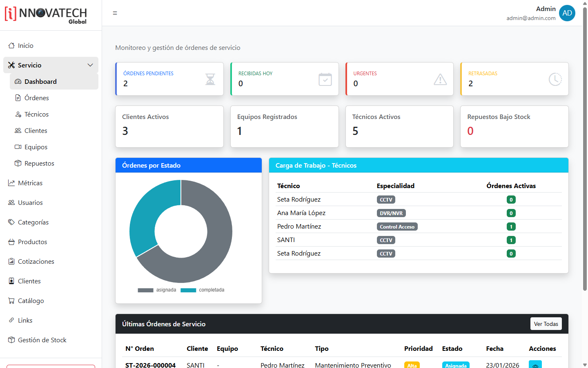
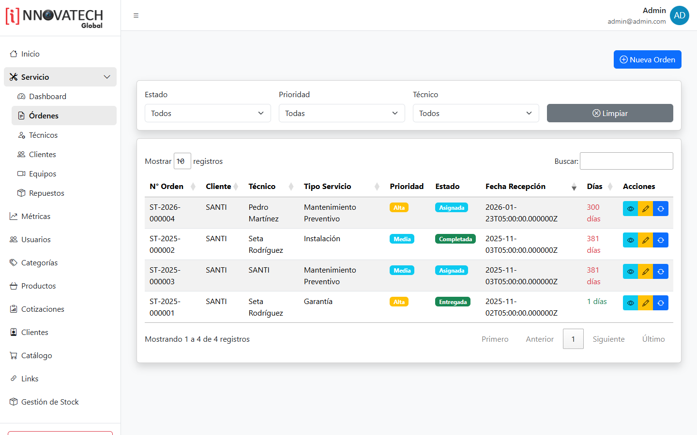
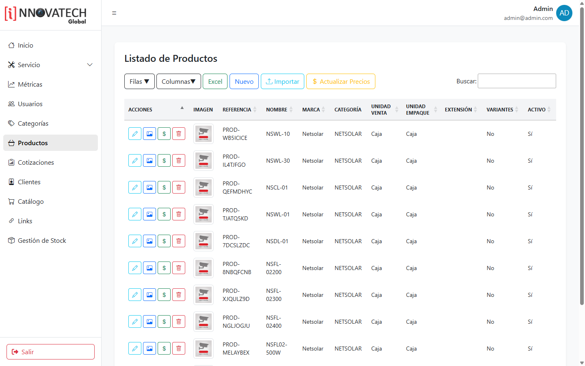

# Innovatech Global — Cotizaciones, ventas y servicio técnico

Sistema para un proveedor de equipos de seguridad electrónica (CCTV, control de acceso): cotizaciones con listas de precios por cliente, inventario por almacén y módulo de servicio técnico.



## Contexto

La empresa vende a instaladores y empresas con precios distintos por tipo de cliente, y además presta soporte técnico. Necesitaban cotizar rápido con su catálogo, medir a sus asesores y hacer seguimiento a cada equipo que entra a reparación.

## Funcionalidades

- **Cotizaciones** con listas de precios por cliente, edición de precios por vendedor, PDF profesional y eliminación lógica (solo admin).
- **Catálogo y productos** con variantes, importación desde Excel y filtros buscables (Select2).
- **Stock por almacén** y movimientos de inventario.
- **Módulo de ventas:** almacenes, metas comerciales y carga de ventas por Excel.
- **Servicio técnico:** órdenes de servicio con prioridad y estados, técnicos y especialidades, equipos de clientes, repuestos usados, historial de estados, fotos y PDF de la orden con firmas.
- **Métricas** de cotizaciones por asesor (aprobadas, pendientes, perdidas).
- Enlaces de acceso para compartir catálogo y cotizaciones.

## Stack

- **Backend:** PHP 8, Laravel 9, MySQL/MariaDB
- **Autenticación y permisos:** Laravel Breeze + spatie/laravel-permission (roles y permisos)
- **Frontend:** Blade, Livewire, Alpine.js, Tailwind CSS, Bootstrap, DataTables, Select2, Chart.js
- **Documentos:** DomPDF, TCPDF, Laravel Excel

## Capturas

**Órdenes de servicio**



**Listado de productos**



**Inicio de sesión**


## Instalación local

Requisitos: PHP 8.0+ (con extensiones `gd`, `zip`, `intl`), Composer, Node 18+ y MySQL/MariaDB.

```bash
git clone <url-del-repositorio>
cd innovatech
composer install
npm install && npm run build
cp .env.example .env        # configura la conexión a la base de datos
php artisan key:generate
php artisan migrate --seed
php artisan serve
```

La aplicación queda disponible en `http://localhost:8000`. Los seeders crean los roles y datos iniciales (revisa `database/seeders`).

## Notas

- Proyecto desarrollado para un cliente real y desplegado en producción. Las capturas se tomaron en un entorno local; el historial de este repositorio se depuró para no incluir credenciales ni copias de bases de datos.

## Autor

**Santiago Bellaizán** — Desarrollador Full Stack (Laravel · PHP · MySQL · JavaScript)

- GitHub: [@Santibc](https://github.com/Santibc)
